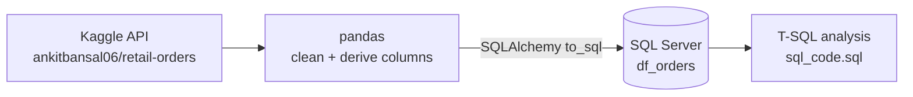

# Retail Orders Analysis — Python ETL → SQL Server → SQL Insights

A small end-to-end analytics project. It downloads a retail orders dataset from Kaggle, cleans it with pandas, loads it into SQL Server, and answers business questions with T-SQL: window functions, CTEs and conditional aggregation.

## Architecture



## Tech stack

Python · pandas · Kaggle API · SQLAlchemy / pyodbc · Microsoft SQL Server (T-SQL)

## What it demonstrates

**ETL (`orders data analysis.py`):**
- downloads and unzips the dataset with the Kaggle CLI
- treats `'Not Available'` / `'unknown'` as nulls
- normalises column names
- derives `discount`, `sale_price` and `profit`
- casts `order_date`, drops intermediate price columns
- appends the result to SQL Server

**Analysis (`sql_code.sql`):**
1. Top 10 revenue-generating products
2. Top 5 best-selling products in each region (`ROW_NUMBER() OVER (PARTITION BY …)`)
3. Month-over-month sales comparison, 2022 vs 2023 (conditional aggregation)
4. Best month by sales for each category
5. Sub-category with the highest sales growth from 2022 to 2023

## Project structure

```
data_analytics_project/
├── orders data analysis.py   # exported notebook: download → clean → load
└── sql_code.sql              # business questions in T-SQL
```

## How to run

1. Set up the [Kaggle API token](https://www.kaggle.com/docs/api) (`~/.kaggle/kaggle.json`) and run `pip install kaggle pandas sqlalchemy pyodbc`.
2. Install SQL Server (Express is fine) and ODBC Driver 17.
3. Change the connection string in the script to your own server name.
4. Run the script in Jupyter. It's an exported notebook and uses `!kaggle …` shell syntax.
5. Run the queries in `sql_code.sql` in SSMS or Azure Data Studio.

> **Note:** in the committed script, the column-renaming and the `discount` / `sale_price` derivation lines are commented out. Uncomment them before running, or the `profit` step fails.

## Possible next steps

- Convert the exported script back into a clean, runnable `.py` (or keep it as a `.ipynb`)
- Create the target table with explicit data types before loading, instead of letting pandas infer them
- Add a Power BI report on top of `df_orders`
